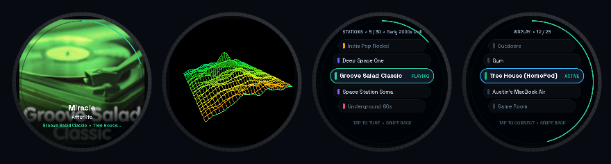
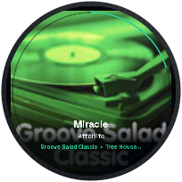
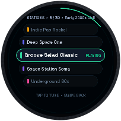
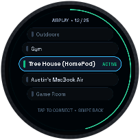
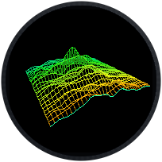
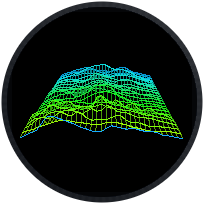
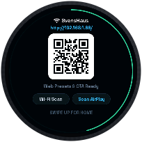

<div align="center">

# 🎛️ AirPlayKnob

**SomaFM Internet Radio to AirPlay 1 & 2 Streamer + 60 FPS Tactile Controller**  
*Built for the [Waveshare ESP32-S3-Knob-Touch-LCD-1.8](https://www.waveshare.com/wiki/ESP32-S3-Knob-Touch-LCD-1.8)*

[](https://platformio.org/)
[](https://lvgl.io/)
[](docs/AIRPLAY_PROTOCOL.md)
[](LICENSE)



**[Features](#-features)** • **[Screenshots](#-ui--visualizer-screenshots)** • **[Controls](#-touch--rotary-controls)** • **[Quick Start](#-quick-start)** • **[Architecture](docs/ARCHITECTURE.md)** • **[AirPlay Protocol](docs/AIRPLAY_PROTOCOL.md)** • **[Hardware Pinout](docs/HARDWARE.md)**

</div>

---

## ✨ Overview

**AirPlayKnob** turns the **[Waveshare ESP32-S3-Knob-Touch-LCD-1.8](https://www.waveshare.com/wiki/ESP32-S3-Knob-Touch-LCD-1.8)** (dual-core 240 MHz ESP32-S3, 8 MB Octal PSRAM, 360×360 round QSPI display, capacitive touch, mechanical rotary encoder ring, DRV2605 haptic motor, and PCM5100A 3.5mm stereo DAC) into a standalone **SomaFM Internet Radio to AirPlay streamer**.

No phone, companion app, or external server is required: the knob connects directly to SomaFM (or any custom MP3 radio stream), decodes stereo audio in real time on the ESP32-S3, fetches live album art, renders a **60 FPS** circular UI and 3D wireframe audio visualizer, and streams lossless RTP ALAC audio directly to **Apple HomePods (OS 17–27+)**, **Sonos**, **Apple TV**, **AirPort Express**, **ShairPort**, or the onboard **3.5mm stereo jack**.

---

## 📸 UI & Visualizer Screenshots

<div align="center">
<table>
  <tr>
    <td align="center" width="33%">
      <br/>
      <b>Now Playing (Home)</b><br/>
      <sub>Full-bleed 360×360 Album Art, bottom gradient scrim, Space Grotesk Bold track typography, and 360° perimeter volume ring.</sub>
    </td>
    <td align="center" width="33%">
      <br/>
      <b>Stations Dial (Swipe Left)</b><br/>
      <sub>60 FPS virtualized 5-slot dial wheel with 30 curated SomaFM channels, color-coded genre pills, and haptic detents.</sub>
    </td>
    <td align="center" width="33%">
      <br/>
      <b>AirPlay Speakers (Swipe Right)</b><br/>
      <sub>Live mDNS-discovered HomePods, Sonos, Apple TVs, MacBooks, and onboard 3.5mm stereo DAC output.</sub>
    </td>
  </tr>
  <tr>
    <td align="center" width="33%">
      <br/>
      <b>WhiteCap 3D Visualizer (Swipe Up)</b><br/>
      <sub>60 FPS 34×26 wireframe terrain with live stereo oscilloscope front edge and orbiting 3D camera.</sub>
    </td>
    <td align="center" width="33%">
      <br/>
      <b>WhiteCap Color Drift & Presets</b><br/>
      <sub>Continuous HSV color drift + 4 tap-selectable palettes rendered directly in internal DMA SRAM.</sub>
    </td>
    <td align="center" width="33%">
      <br/>
      <b>Settings & Web QR (Swipe Down)</b><br/>
      <sub>On-device Wi-Fi scanner with touch keyboard, AirPlay rescan, and QR code for the embedded Web Portal.</sub>
    </td>
  </tr>
</table>
</div>

---

## 🚀 Features

- **📻 30 Pre-Loaded SomaFM Channels + Custom Streams**:
  - Ships with 30 curated SomaFM stations (*Groove Salad*, *Groove Salad Classic*, *Drone Zone*, *DEF CON Radio*, *Secret Agent*, *Space Station Soma*, *Underground 80s*, *Lush*, *Vaporwaves*, *Indie Pop Rocks!*, *Beat Blender*, *Deep Space One*, *Synphaera*, and more).
  - Automatic stream server failover (`ice6.somafm.com` $\to$ `ice2` $\to$ `ice4`) and live ICY `StreamTitle` metadata extraction.
  - Add, edit, or reorder up to 48 custom MP3 radio streams via the embedded Web UI (persisted in ESP32 NVS flash).
- **🔊 Universal AirPlay 1 (RAOP) & AirPlay 2 Streaming Engine**:
  - **AirPlay 2 (`HomePod` / `HomePod mini` / `Apple TV` on OS 17–27+)**: Full HomeKit Transient Pair-Setup (`POST /pair-setup` TLV8 `M1..M4`, 3072-bit SRP-6a with SHA-512, HKDF-SHA-512 session keys), framed `ChaCha20-Poly1305` encrypted RTSP control & event channels, two-phase binary plist (`bplist00`) `SETUP`, and `ChaCha20-Poly1305` encrypted RTP audio frames.
  - **AirPlay 1 / RAOP (`Sonos`, `AirPort Express`, `ShairPort`, legacy receivers)**: Supports both `/auth-setup` Curve25519 ECDH (required by Sonos) and RSA-OAEP `AES-128-CBC` SDP `ANNOUNCE`.
  - **Glitch-Free Buffering & Async Control**: **2.0 MB PSRAM PCM ringbuffer** (~11.6 seconds of 44.1 kHz 16-bit stereo audio), **64 KB MP3 buffer**, 512-packet UDP retransmission backlog, dedicated Core 0 microsecond NTP timing responder task, and non-blocking async RTSP volume worker task.
- **🎧 Simultaneous Onboard 3.5mm Stereo DAC Output**:
  - Drives the onboard **TI PCM5100A** I2S stereo DAC via the `CH445P` analog mux (`GPIO 0`) so you can plug headphones or powered speakers directly into the knob's 3.5mm jack alongside—or instead of—AirPlay streaming.
- **🎨 60 FPS Circular Touchscreen UI & Old-School "WhiteCap" 3D Visualizer**:
  - **Full-Bleed 360×360 Live Album Art**: Queries the Apple iTunes Search API for live track cover art (`160×160` baseline JPEG decoded via hardware ROM `tjpgd`), falls back to official SomaFM channel art, and performs a smooth 2D bilinear upscale to `360×360` with a pre-multiplied bottom gradient scrim.
  - **60 FPS "WhiteCap" 3D Wireframe Terrain**: Renders an `884`-vertex (`34×26`) 3D mountain waterfall mesh driven by real-time signed stereo PCM samples on the front edge, Automatic Gain Control (AGC), an orbiting 3D perspective camera, and subtle HSV palette drift—rasterized directly into 240 MHz internal DMA SRAM with zero PSRAM bandwidth overhead.
  - **Custom `Space Grotesk` 4-bpp Anti-Aliased Typography**: Five custom-compiled LVGL font weights (`13px`, `15px`, `17px`, `20px`, `22px`) including full Latin punctuation and smart quotes.
  - **DRV2605 Haptic Feedback**: Physical tactile clicks and detents on every knob rotation, station tune, and gesture.
  - **180° Inverted Cable Orientation**: Display (`SH8601`), touch (`CST816S`), and rotary encoder are oriented so the USB-C power cable exits cleanly from the **top (12 o'clock)**.
- **🌐 Embedded Web Portal & Wireless OTA Updates**:
  - Dark-mode responsive Web UI at `http://airplayknob.local/` (or device IP) for live playback control, station preset management, speaker switching, Wi-Fi configuration, and `.bin` firmware upload.
  - Native wireless `ArduinoOTA` support on port `3232`.

---

## 🧭 Touch & Rotary Controls

### 4-Way Swipe Navigation (from Home Screen)

| Gesture / Input | Action |
| :--- | :--- |
| **Swipe Left** (`←`) | Open **Stations Dial** (30 SomaFM channels; turn knob or drag to scroll, tap center pill to tune) |
| **Swipe Right** (`→`) | Open **AirPlay Speakers Dial** (turn knob or drag to scroll, tap center pill to route audio) |
| **Swipe Up** (`↑`) | Launch full-screen **60 FPS WhiteCap 3D Visualizer** (tap screen to cycle color palettes; swipe down to exit) |
| **Swipe Down** (`↓`) | Open **Settings & Web Portal QR** (scan Wi-Fi networks with on-screen keyboard or rescan AirPlay speakers) |
| **Rotate Outer Knob** | Adjusts **Volume** (`0–100%`) on Home/Visualizer (with floating HUD pill), or scrolls the **Stations / Speakers** dial at 60 FPS |
| **Tap Center Artwork** | Toggle **Play / Pause** with haptic click |
| **Tap Bottom Metadata Line** | Cycle rotary knob mode on Home screen (`VOL` $\to$ `TUNE STATION` $\to$ `AIRPLAY SPEAKER`) |

---

## 🛠️ Hardware Pinout

Built for the **[Waveshare ESP32-S3-Knob-Touch-LCD-1.8](https://www.waveshare.com/wiki/ESP32-S3-Knob-Touch-LCD-1.8)**. See [`docs/HARDWARE.md`](docs/HARDWARE.md) for full electrical and driver details.

| Subsystem | Controller / IC | ESP32-S3 Pins |
| :--- | :--- | :--- |
| **Display (360×360 QSPI)** | SH8601 / ST77916 | `CS=14`, `PCLK=13`, `D0=15`, `D1=16`, `D2=17`, `D3=18`, `RST=21`, `BL=47` |
| **Capacitive Touch** | CST816S (`0x15`) | `SDA=11`, `SCL=12`, `RST=10`, `INT=9` |
| **Haptic Motor Driver** | DRV2605 (`0x5A`) | `SDA=11`, `SCL=12` (shared `I2C_NUM_0`) |
| **Rotary Encoder** | SSCM110100 Pulse Switch | `ECA=8`, `ECB=7` |
| **Audio DAC (3.5mm Jack)** | PCM5100A + CH445P | `BCLK=39`, `WS=40`, `DOUT=41`, `MUX_SEL=0 (HIGH)` |

---

## ⚡ Quick Start

### 1. Prerequisites
Install **[PlatformIO](https://platformio.org/)** (VS Code extension or PlatformIO Core CLI). All library dependencies (`LVGL 8.3.11`) and ESP32-S3 partition tables (`partitions.csv`) are configured automatically by [`platformio.ini`](platformio.ini).

### 2. Configure Wi-Fi (Optional Compile-Time or On-Screen)
You can connect to Wi-Fi in either of two ways:
1. **Directly on the Touchscreen (No code changes needed)**: Flash the firmware, **Swipe Down** on the screen, tap **Wi-Fi Scan**, select your network, and enter your password on the touch keyboard. Credentials are saved automatically to ESP32 NVS flash.
2. **Compile-Time (`include/secrets.h`)**: Copy [`include/secrets.example.h`](include/secrets.example.h) to `include/secrets.h` (which is gitignored) and set your SSID and password:
   ```bash
   cp include/secrets.example.h include/secrets.h
   ```
   ```cpp
   // include/secrets.h
   #define DEFAULT_WIFI_SSID  "YourNetworkSSID"
   #define DEFAULT_WIFI_PASS  "YourNetworkPassword"
   ```

### 3. Build & Flash via USB-C
```bash
# Compile firmware
pio run

# Flash over USB-C
pio run -t upload

# Monitor serial output & interactive debug CLI (115200 baud)
pio device monitor -b 115200
```

### 4. Wireless OTA Updates
Once connected to Wi-Fi, you can push firmware updates wirelessly via `ArduinoOTA` or upload `.bin` files in the browser at `http://airplayknob.local/`:
```bash
pio run -t upload --upload-port airplayknob.local
```

---

## 🌐 REST API & Serial Debug CLI

### HTTP JSON Endpoints (`Port 80`)
- **`GET /`** — Embedded responsive dark-mode Web Portal UI.
- **`GET /api/status`** — Live JSON state (current station, ICY track title, album art URL, playback status, volume, Wi-Fi IP/SSID, presets array, and discovered AirPlay speakers).
- **`POST /api/control`** — Control playback, routing, and UI:
  ```json
  { "preset": 4, "play": true, "volume": 28, "speaker": 2, "toggle_whitecap": true }
  ```
- **`POST /api/presets`** — Add, update, delete, or reset station presets (`action`: `"add" | "update" | "delete" | "reset"`).
- **`POST /api/wifi`** — Save and connect to a new Wi-Fi network (`{ "ssid": "...", "pass": "..." }`).
- **`GET /api/screenshot.bmp`** — Streams a live `360×360` 24-bit BMP capture of the display framebuffer.
- **`POST /api/ota`** — Multipart `.bin` firmware upload for browser-based OTA updates.

### USB Serial Debug Commands (`115200 baud`)
Send newline-terminated commands over USB-Serial/JTAG:
- `STATUS` — Prints active tab, FPS, audio ringbuffer fill (`BufMs`), heap/PSRAM free bytes, and all discovered AirPlay speakers.
- `FPS` — Prints instantaneous display flush FPS and frame duration in microseconds.
- `TAB <0..3>` — Switches active UI screen (`0`=Home, `1`=Stations, `2`=Speakers, `3`=Settings).
- `SWIPE <L|R|U|D>` — Simulates a 4-way touch swipe gesture.
- `WHITECAP <0|1>` — Toggles the 60 FPS WhiteCap 3D visualizer.
- `ROTATE <delta>` — Simulates rotary encoder rotation (`e.g., ROTATE 1`, `ROTATE -1`).
- `VOL <0..100>` — Sets volume percentage.
- `SPEAKER <idx>` — Routes audio to discovered speaker index `<idx>`.
- `SCREENSHOT` — Dumps a Base64-encoded RGB565 screenshot over serial (`===SCREENSHOT_BEGIN 180 180===`).

---

## 📂 Project Structure & Deep-Dive Docs

```text
AirPlayKnob/
├── docs/
│   ├── ARCHITECTURE.md         # Dual-core FreeRTOS tasks, SRAM vs PSRAM, 60 FPS WhiteCap engine
│   ├── AIRPLAY_PROTOCOL.md     # AirPlay 1 (RAOP) & AirPlay 2 (HomeKit SRP-6a + ChaCha20-Poly1305)
│   ├── HARDWARE.md             # Waveshare ESP32-S3-Knob pinout, SH8601 QSPI, CST816S, DRV2605, DAC
│   └── images/                 # Live device screenshots & UI showcase banner
├── include/
│   ├── app_state.h             # Global state mutex, presets, speaker table, waveform buffers
│   ├── artwork_fetcher.h       # 360x360 live album art & SomaFM artwork pipeline
│   ├── knob_ui.h               # Circular LVGL UI & 60 FPS WhiteCap 3D visualizer interface
│   ├── lv_conf.h               # LVGL 8.3 configuration optimized for ESP32-S3 DMA + PSRAM
│   ├── minimp3.h               # Single-header MP3 decoder
│   ├── plist_bin.h             # Lightweight Apple Binary Plist (bplist00) parser & builder
│   ├── radio_streamer.h        # HTTP ICY client, MP3 decode task, and audio output task
│   ├── raop_AnySpeaker.h       # AirPlay 1 & AirPlay 2 RTSP/RTP client class
│   ├── secrets.example.h       # Template for optional compile-time Wi-Fi credentials
│   ├── somafm_presets.h        # 30 curated SomaFM station definitions & theme colors
│   └── ui_fonts.h              # Custom 4-bpp Space Grotesk LVGL font declarations
├── src/
│   ├── main.cpp                # Boot sequence, NVS persistence, mDNS discovery, OTA, Serial CLI
│   ├── audio/
│   │   ├── artwork_fetcher.cpp # iTunes Search API + SomaFM JPEG decode + bilinear 360x360 upscale
│   │   ├── plist_bin.c         # Binary plist encoder/decoder for AirPlay 2 SETUP handshakes
│   │   ├── radio_streamer.cpp  # 2MB PSRAM ringbuffer, ICY parser, RTP pacing, async RTSP worker
│   │   └── raop_AnySpeaker.cpp # AirPlay 1 & 2 crypto, SRP-6a, ChaCha20-Poly1305, NTP sync
│   ├── bsp/                    # Board Support Package (SH8601 QSPI, CST816S touch, DRV2605, I2S DAC)
│   ├── crypto/                 # Curve25519 Donna implementation for Sonos /auth-setup
│   └── ui/
│       ├── knob_ui.cpp         # 4-way swipe UI, O(1) virtualized wheels, 60 FPS WhiteCap 3D renderer
│       ├── web_portal.cpp      # Embedded Web Server, dark-mode SPA, REST API, and BMP screenshot
│       └── fonts/              # Custom Space Grotesk 4-bpp C font bitmaps (13px..22px)
├── partitions.csv              # Custom 16MB flash layout with dual 3MB OTA app partitions
└── platformio.ini              # PlatformIO build configuration for ESP32-S3 Octal PSRAM
```

---

## 📄 License

Released under the [MIT License](LICENSE). Feel free to fork, remix, and build your own tactile streaming controllers!
