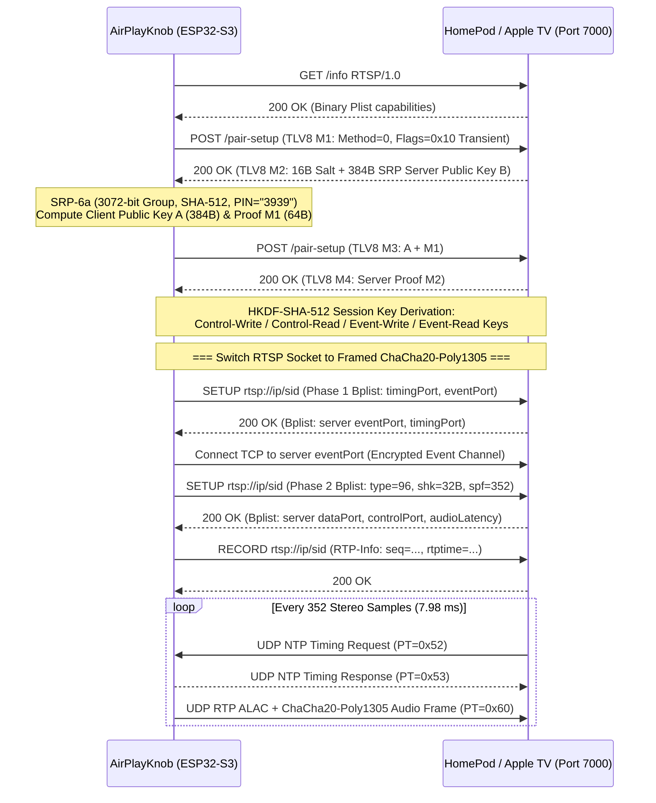

# AirPlay 1 (RAOP) & AirPlay 2 Protocol Implementation

`AirPlayKnob` includes a clean-room, self-contained C++ AirPlay transmitter (`src/audio/raop_AnySpeaker.cpp` and `include/raop_AnySpeaker.h`) capable of streaming real-time 44.1 kHz 16-bit stereo audio from an ESP32-S3 to both legacy **AirPlay 1 (RAOP)** receivers and modern **AirPlay 2** speakers (including Apple HomePod & HomePod mini running HomePod OS 17–27+, Apple TV, Sonos Era/Arc/Move/Roam, AirPort Express, and ShairPort-Sync).

---

## 1. mDNS Discovery & Speaker Classification

Every AirPlay receiver advertises a `_raop._tcp.local` service over mDNS with an instance name formatted as `<MAC>@<Friendly Speaker Name>` and TXT records describing its capabilities:

| TXT Key | Meaning | Values Handled |
| :--- | :--- | :--- |
| `am` | Apple Model identifier | `AudioAccessory1,1` / `5,1` / `6,1` (HomePod / mini), `AppleTV*`, `Arc` / `Era 300` / `Move` (Sonos), `AirPort*` |
| `et` | Supported encryption types | `0` (None), `1` (RSA + AES-128-CBC), `3` (FairPlay), `4` (MFi / `/auth-setup` Curve25519), `5` (FairPlay SAPv2.5) |
| `cn` | Supported audio codecs | `0` (PCM), `1` (ALAC - Apple Lossless), `2` (AAC), `3` (AAC-ELD) |
| `pk` | Ed25519 public key | Present on AirPlay 2 / HomeKit-enabled receivers |

### Automatic Protocol Selection
When `RaopClient::connect()` connects to port `7000` (or the mDNS-advertised RTSP port), it probes `GET /info RTSP/1.0`:
- If the speaker returns `200 OK` with an `application/x-apple-binary-plist` body whose `statusFlags` has bit `0x04` (`SupportsTransientPairing`) or is an `AudioAccessory` / `AppleTV` model advertising `et=3,5`, `RaopClient` selects the **AirPlay 2** pipeline.
- Otherwise, it selects the **AirPlay 1 (RAOP)** pipeline (using `/auth-setup` Curve25519 ECDH if `et` includes `4` for Sonos, or RSA-OAEP `AES-128-CBC` if `et` includes `1`).

---

## 2. AirPlay 2 Pipeline (HomeKit Transient Pairing + ChaCha20-Poly1305)

Modern Apple HomePods and Apple TVs reject legacy RAOP `ANNOUNCE` handshakes (`403 Forbidden`) and require **HomeKit Transient Pair-Setup** followed by **ChaCha20-Poly1305** encrypted binary-plist `SETUP` phases.

### Key Cryptographic Details
1. **HomeKit Transient SRP-6a (`doAp2PairTransient`)**:
   - Uses the fixed transient PIN `"3939"` with the RFC 5054 3072-bit prime $N$ and generator $g = 5$.
   - Computes multiplier $k = \text{SHA512}(N \parallel \text{pad}(g))$, private key $x = \text{SHA512}(\text{salt} \parallel \text{SHA512}(\text{"Pair-Setup:"} \parallel \text{"3939"}))$, verifier $v = g^x \bmod N$, and shared secret $S = (B - k \cdot v)^{a + u \cdot x} \bmod N$ using hardware-accelerated `mbedtls_mpi_exp_mod`.
   - Derives the shared session key $K = \text{SHA512}(S)$ and verifies mutual proofs $M_1, M_2$.
2. **HKDF-SHA-512 Channel Keys**:
   - Control encryption keys use salt `"Control-Salt"` with info `"Control-Write-Encryption-Key"` (client $\to$ speaker) and `"Control-Read-Encryption-Key"` (speaker $\to$ client).
   - Event channel keys use salt `"Events-Salt"` with info `"Events-Write-Encryption-Key"` and `"Events-Read-Encryption-Key"`.
3. **Framed RTSP ChaCha20-Poly1305**:
   - Every encrypted RTSP block is prefixed with a 2-byte little-endian plaintext length (up to `1024` bytes per block), which is passed as the **Additional Authenticated Data (AAD)** to `mbedtls_chachapoly_encrypt_and_tag`, followed by the ciphertext and 16-byte Poly1305 tag.
   - The 96-bit nonce consists of 4 zero bytes followed by the 64-bit little-endian block counter (`counter++`).
4. **RTP Audio Packet ChaCha20-Poly1305**:
   - Each 352-sample stereo frame (`1,408` bytes of PCM) is wrapped in a 3-byte uncompressed ALAC frame header (`0x20 0x00 0x12` bit-shifted across the `1,408` big-endian samples = `1,411` bytes).
   - Encrypted with the 32-byte stream key `shk` sent during `SETUP` Phase 2, using bytes `4..11` of the 12-byte RTP header (`timestamp` + `SSRC`) as the 8-byte AAD, and appending the 16-byte Poly1305 tag + 8-byte little-endian packet nonce at the end of the UDP datagram (`12 + 1411 + 16 + 8 = 1,447` bytes total).

---

## 3. AirPlay 1 (RAOP) Pipeline (Sonos, AirPort Express, ShairPort)

For AirPlay 1 receivers:
1. **Sonos Curve25519 MFi Handshake (`POST /auth-setup`)**:
   - Sends a 33-byte payload (`0x01` + 32-byte ephemeral Curve25519 public key) so Sonos speakers accept unauthenticated RAOP sessions without requiring an Apple MFi hardware coprocessor.
2. **SDP `ANNOUNCE`**:
   - Negotiates `rtpmap:96 AppleLossless` (`fmtp:96 352 0 16 40 10 14 2 255 0 0 44100`).
   - If the receiver advertises `et=1`, generates a random 16-byte AES key and 16-byte IV, encrypts the AES key using the Apple Airport RSA public key (`RSA-OAEP-SHA1`), and includes `a=rsaaeskey:` and `a=aesiv:` in the SDP body.
3. **Transport `SETUP` & `RECORD`**:
   - Negotiates UDP `server_port`, `control_port`, and `timing_port` over `Transport: RTP/AVP/UDP;unicast;mode=record`.
   - Encrypts each 352-sample uncompressed ALAC frame with `AES-128-CBC` (resetting the IV to `m_aes_iv` per packet per the RAOP specification).

---

## 4. NTP Timing Synchronization & UDP Retransmission

- **Timing Sync (`PT=0x52` / `PT=0x53`)**: A dedicated high-priority FreeRTOS task (`timingTaskLoop`) listens on `m_local_time_port` and immediately echoes the speaker's 64-bit NTP originate timestamp along with the ESP32's current microsecond clock converted to NTP epoch (`0x83AA7E80` seconds offset).
- **RTP Sync Packets (`PT=0x54`)**: Sent every 1.0 second on the control socket, mapping the current RTP sample timestamp (`m_head_ts`) to the wall-clock NTP timestamp, with `m_latency_frames = 44100` (1.0s buffer) so the speaker has ample jitter margin.
- **UDP Retransmission (`PT=0x55` $\to$ `PT=0x56`)**: All outgoing RTP packets are stored in a 512-slot PSRAM circular buffer (`m_backlog`, covering ~4 seconds of audio). If the speaker reports a missed UDP sequence range via `PT=0x55` on the control port, `handleControlSocket()` immediately re-sends the requested packets wrapped in a `PT=0x56` retransmission header.
