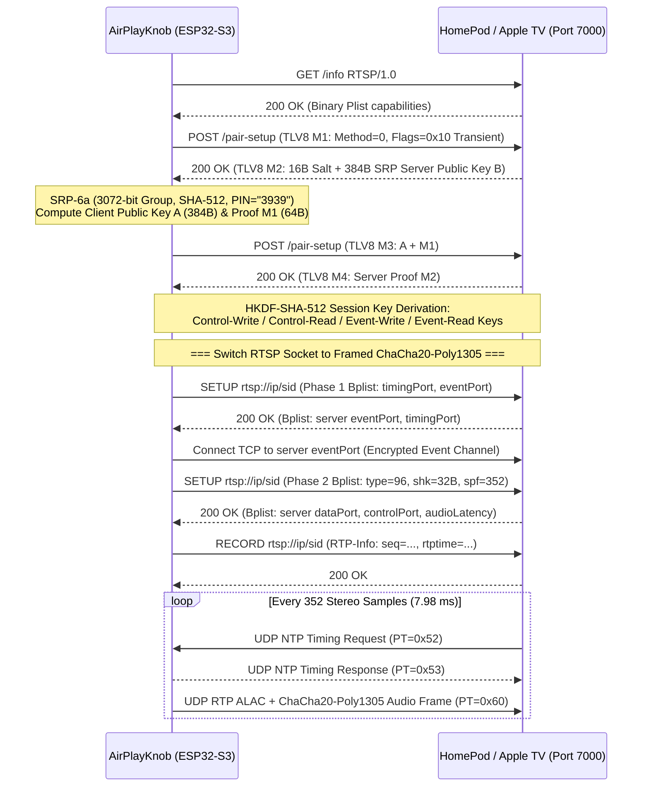

# AirPlay 1 (RAOP) & AirPlay 2 Protocol Implementation

`AirPlayKnob` implements a self-contained C++ AirPlay transmitter (`src/audio/raop_AnySpeaker.cpp` and `include/raop_AnySpeaker.h`) for real-time 44.1 kHz 16-bit stereo audio across **AirPlay 1 (RAOP)** and **AirPlay 2** transports, plus optional **Native Sonos UPnP/SOAP** radio control. See the [network audit](NETWORK_AUDIT_2026-11.md) and [regression audit](AIRPLAY_REGRESSION_2026-11.md) for qualification details and receiver notes.

---

## 1. Two-Pass mDNS Discovery & Speaker Classification

`discover_airplay_speakers()` (`src/main.cpp`) performs a **two-pass PSRAM-backed mDNS scan** (`_airplay._tcp.local` followed by `_raop._tcp.local`, capturing up to 48 receivers) so dense multi-room HomePod, Apple TV, and Sonos fleets do not overflow fixed single-query result buffers. Discovered AirPlay speakers are deduplicated by IP/name and **sorted case-insensitively (`A -> Z`)**, keeping `Local 3.5mm Jack` pinned at the end of the dial.

RAOP instances commonly advertise `<MAC>@<Friendly Speaker Name>`, with TXT records describing capabilities:

| TXT Key | Meaning | Values Handled |
| :--- | :--- | :--- |
| `am` | Apple Model identifier | `AudioAccessory1,1` / `5,1` / `6,1` (HomePod / mini), `AppleTV*`, `Arc` / `Era 300` / `Five` / `Move` (Sonos), `AirPort*` |
| `et` | Supported encryption types | `0` (None), `1` (RSA + AES-128-CBC), `3` (FairPlay), `4` (MFi / `/auth-setup` Curve25519), `5` (FairPlay SAPv2.5) |
| `cn` | Supported audio codecs | `0` (PCM), `1` (ALAC - Apple Lossless), `2` (AAC), `3` (AAC-ELD) |
| `pk` | Ed25519 public key | Present on AirPlay 2 / HomeKit-enabled receivers |

### Protocol Selection
`RaopClient::connect()` probes `GET /info RTSP/1.0` on the advertised RTSP port (`7000` or dynamic AirPlay port) and inspects capability flags, model identifiers, and cached pairing keys to select **AirPlay 2** (`SETUP` binary plist + `ChaCha20-Poly1305`) or **AirPlay 1 / RAOP** (`/auth-setup` Curve25519 and/or RSA-OAEP `AES-128-CBC` SDP `ANNOUNCE`).

---

## 2. AirPlay 2 Pipeline (HomeKit Pairing + ChaCha20-Poly1305)

Modern Apple HomePods and Apple TVs reject legacy RAOP `ANNOUNCE` handshakes (`403 Forbidden`) and require **HomeKit Pair-Setup / Pair-Verify** followed by **ChaCha20-Poly1305** encrypted binary-plist `SETUP` phases.

### Key Cryptographic Details
1. **HomeKit Transient SRP-6a (`doAp2PairTransient`) & Persistent PIN Pairing (`promptAndPairWithPin`)**:
   - For standard speakers allowing transient pairing (`Flags=0x10`), uses fixed PIN `"3939"` with the RFC 5054 3072-bit prime $N$ and generator $g = 5$.
   - Computes multiplier $k = \text{SHA512}(N \parallel \text{pad}(g))$, private key $x = \text{SHA512}(\text{salt} \parallel \text{SHA512}(\text{"Pair-Setup:"} \parallel \text{PIN}))$, verifier $v = g^x \bmod N$, and shared secret $S = (B - k \cdot v)^{a + u \cdot x} \bmod N$ using hardware-accelerated `mbedtls_mpi_exp_mod`, then derives $K = \text{SHA512}(S)$ and verifies mutual proofs $M_1, M_2$.
   - For receivers requiring an on-screen 4-digit PIN (e.g., Apple TV with PIN security), supports full `M1..M6` Ed25519 long-term identity exchange persisted in NVS followed by fast `Curve25519` + `Ed25519` **`POST /pair-verify`** on subsequent connections.
2. **HKDF-SHA-512 Channel Keys**:
   - Control encryption keys use salt `"Control-Salt"` with info `"Control-Write-Encryption-Key"` (client $\to$ speaker) and `"Control-Read-Encryption-Key"` (speaker $\to$ client).
   - Event channel keys use salt `"Events-Salt"` with info `"Events-Write-Encryption-Key"` and `"Events-Read-Encryption-Key"`.
3. **Framed RTSP ChaCha20-Poly1305 & CSeq Matching**:
   - Every encrypted RTSP block is prefixed with a 2-byte little-endian plaintext length (up to `1024` bytes per block), passed as **Additional Authenticated Data (AAD)** to `mbedtls_chachapoly_encrypt_and_tag`, followed by ciphertext and 16-byte Poly1305 tag (`nonce = 4 zero bytes || 64-bit LE block counter`).
   - Synchronous RTSP transactions strictly match response `CSeq` headers against the request `CSeq`, safely draining interleaved asynchronous replies.
4. **RTP Audio Packet ChaCha20-Poly1305**:
   - Each 352-sample stereo frame (`1,408` bytes of PCM) carries a 23-bit uncompressed ALAC CPE header with `has_size=1`, an explicit 32-bit sample count (`352`), big-endian PCM samples, a 3-bit `ID_END`, and byte padding (`1,416` bytes total). Including the explicit 32-bit sample count ensures bit-exact decoding even on receivers whose ALAC decoder defaults to 4096-sample frames.
   - Encrypted with the 32-byte stream key `shk` sent during `SETUP` Phase 2, using bytes `4..11` of the 12-byte RTP header (`timestamp` + `SSRC`) as the 8-byte AAD, and appending the 16-byte Poly1305 tag + 8-byte little-endian packet nonce (`12 + 1416 + 16 + 8 = 1,452` bytes total).

---

## 3. AirPlay 1 (RAOP) Pipeline (Sonos, AirPort Express, ShairPort)

For AirPlay 1 receivers:
1. **Sonos Curve25519 MFi Handshake (`POST /auth-setup`)**:
   - Sends a 33-byte payload (`0x01` + 32-byte ephemeral Curve25519 public key) so Sonos speakers accept unauthenticated RAOP sessions without requiring an Apple MFi hardware coprocessor.
2. **SDP `ANNOUNCE`**:
   - Negotiates `rtpmap:96 AppleLossless` (`fmtp:96 352 0 16 40 10 14 2 255 0 0 44100`).
   - If the receiver advertises `et=1`, generates a random 16-byte AES key and 16-byte IV, encrypts the AES key using the Apple AirPort RSA public key (`RSA-OAEP-SHA1`), and includes `a=rsaaeskey:` and `a=aesiv:` in the SDP body.
3. **Transport `SETUP` & `RECORD`**:
   - Negotiates UDP `server_port`, `control_port`, and `timing_port` over `Transport: RTP/AVP/UDP;unicast;mode=record`.
   - Encrypts each 352-sample uncompressed ALAC frame with `AES-128-CBC` (resetting the IV to `m_aes_iv` per packet per the RAOP specification).

---

## 4. NTP Timing Synchronization, Monotonic RTP Clock & Lossless Retransmission

Sustained, dropout-free AirPlay 2 playback on Apple HomePod requires strict monotonic RTP-to-NTP clock mapping and zero locally dropped RTP sequence numbers:

- **Dedicated Core 0 Timing Responder (`PT=0x52` / `PT=0x53`)**: A persistent high-priority task (`raop_ntp`, Core 0, Priority 5, PSRAM stack) listens on `m_local_time_port` and immediately echoes the speaker's 64-bit NTP originate timestamp alongside receive/transmit timestamps derived from `esp_timer_get_time()` (`0x83AA7E80` NTP epoch offset).
- **Monotonic Wall-Clock RTP Sync (`PT=0xD4` / `0x54`)**: Sent once per second on the control socket (`0x90 | 0x54` initially, `0x80 | 0x54` thereafter). Crucially, `sendSyncPacket()` computes `sync_rtp_ts = (uint32_t)ntp_to_ts(sync_ntp, 44100)` directly from the monotonic wall-clock `sync_ntp` reference (with `rtp_ts_latency = sync_rtp_ts - m_latency_frames`, where `m_latency_frames` defaults to `88200` / `2.0 s` for AirPlay 2 unless overridden by the speaker's `audioLatency`, and `44100` / `1.0 s` for RAOP) rather than substituting `m_head_ts`. Using `m_head_ts` during transient Wi-Fi TX queue lag would shift the speaker's playout clock backward and then snap it forward upon catch-up, causing audible resync dropouts even when zero packets are lost.
- **Lossless Local-Backpressure Hold (`flushUnsentPacket()`)**: Because ESP32-S3 lwIP allocates outbound UDP `PBUF_RAM` packets in PSRAM and stages them through `64` `cache_tx_buf` slots (`__wrap_esp_wifi_init`) into `48` dynamic MAC TX buffers, local `ENOMEM` is rare—and if `sendto()` ever returns `ENOMEM`, the exact encrypted RTP packet is held in `m_unsent_pkt` for up to `750 ms` (probed every `4 ms`) before advancing `m_seq`, preventing self-inflicted RTP sequence gaps. Afterward, `raop_tx` drains queued PCM gently (`6.0 ms` intervals when `< 250 ms` behind wall clock, `7.5 ms` when `>= 250 ms` behind) instead of flooding the MAC with unpaced bursts.
- **Fast Paced UDP NACK Repair (`PT=0x55` $\to$ `PT=0x56`)**: Outgoing RTP packets are retained in a 512-slot PSRAM circular buffer (`m_backlog`, covering ~4.1 seconds of audio), and `m_ctrl_sock` uses a `16 KiB` `SO_RCVBUF` so bursty NACK datagrams are never dropped. Requested sequence ranges are queued into a deduplicated 64-slot pending ring and transmitted at `4.0 ms` intervals (`2.5 ms` post-audio guard, `20 ms` hold after any local reject) wrapped in a `PT=0x56` retransmission header, easily outrunning HomePod's `2.0 s` playout cushion.

---

## 5. Wi-Fi QoS (`DSCP CS5` / `AC_VI`), 802.11n HT20 & Decoder Regression Check

Audio, control, and timing UDP sockets set `IP_TOS = 0xA0` (**DSCP CS5**, IP precedence 5) while operating in **802.11b/g/n HT20** mode with `WIFI_PS_NONE`:
- Unlike `0xB8` (`DSCP EF`), which RFC 8325 / enterprise access points map to `AC_VO` (voice, disabling A-MPDU aggregation on the AP-to-HomePod hop and inflating per-packet airtime overhead), `0xA0` (`DSCP CS5`) maps cleanly to **`AC_VI` (video)** on both [ESP-IDF's Wi-Fi QoS mapper](https://docs.espressif.com/projects/esp-idf/en/v5.5.3/esp32s3/api-guides/wifi.html#wi-fi-qos) and downstream Wi-Fi APs. This prioritizes audio over best-effort TCP traffic while preserving **802.11n A-MPDU frame aggregation** across both wireless hops.

Run `python3 tests/test_alac_packets.py` (with a host C++ compiler and FFmpeg installed) to compile the firmware ALAC encoder and verify bit-exact PCM recovery across silence, signed extremes, and independent stereo waveforms under both 352-frame and 4096-frame decoder configurations.

---

## 6. Native Sonos Radio Output

Recognized Sonos receivers are verified against their device description XML on port `1400`. When `prefer_sonos_native` is enabled (the default for Sonos speakers), AirPlayKnob uses native `AVTransport` and `RenderingControl` SOAP actions to hand the SomaFM/custom MP3 stream URI directly to the Sonos speaker:
- Sonos fetches and decodes the radio stream directly; no RTP audio is relayed over Wi-Fi by the knob. Existing matching URIs are reused on reconnect so an already-playing speaker continues uninterrupted across controller reboots.
- When both onboard 3.5mm DAC output (`also_local_dac`) and WhiteCap are off, local MP3/PCM decoding stays idle (`Audio buffered by Sonos`), and track metadata is polled from the Sonos receiver every 10 seconds. Opening WhiteCap or enabling the 3.5mm jack starts an independent local audio monitor without interrupting the Sonos stream.
- Set `{"prefer_sonos_native": false}` via `/api/control` (or uncheck **Use direct radio playback on Sonos** in the Web Portal) to stream standard AirPlay RTP audio to Sonos instead.
